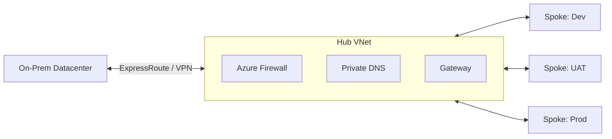

# Gunjan Kumar — Cloud & DevSecOps Engineer

**Engineering Secure, Governed and Scalable Azure Platforms**

*Landing Zones • Infrastructure as Code • CI/CD Automation • Cloud Migration*

 

---

## 👨‍💻 About Me

I am a **DevSecOps Engineer** who designs and automates enterprise-grade cloud platforms on **Microsoft Azure**. My work focuses on building **secure, governed and cost-optimised** environments using **Terraform** and **Azure DevOps**, and on leading **large-scale migrations** from on-premises datacenters to the cloud.

With a background that started in **telecom infrastructure (2019)** and evolved into **cloud and DevSecOps**, I bring a strong operations mindset to platform engineering: *if it is not automated, monitored and recoverable, it is not production-ready.*

---

## 🎯 What I Do

| Domain | Focus |
|--------|-------|
| 🏛️ **Landing Zones** | CAF-aligned design, Management Group hierarchy, subscription vending |
| 🌐 **Networking** | Hub & Spoke, Azure Firewall, Private Endpoints, VPN / ExpressRoute |
| 🔐 **Security & Governance** | Azure Policy, RBAC, Entra ID, Defender for Cloud |
| ⚙️ **IaC & Automation** | Terraform modules, remote state, drift detection, policy-gated pipelines |
| 🔁 **CI/CD** | Azure Repos, Azure DevOps Pipelines, trunk-based branching, PR controls |
| 🚚 **Cloud Migration** | Discovery → Assessment → Cutover → Hypercare for 100+ applications |
| 💰 **FinOps** | Right-sizing, reservations, auto shutdown, log ingestion control |
| 💾 **Resilience** | Backup, DR, HA, RTO / RPO planning |
| 📊 **Observability** | Azure Monitor, Log Analytics, alerting and dashboards |

---

## 🛠️ Tech Stack

---

## 🏗️ Reference Architecture

---

## 📌 Featured Project

### 🏛️ [Enterprise Azure Landing Zone & Cloud Migration Playbook](https://github.com/gunjanrajput026-ctrl/azure-landing-zone-playbook)

A complete blueprint for migrating **100+ applications** across Dev, UAT and Production — covering CAF strategy, Management Groups, Hub & Spoke networking, Terraform automation, DevSecOps pipelines, FinOps, DR and vendor governance.

`Azure` `Terraform` `Azure DevOps` `CAF` `DevSecOps`

---

## 💼 Experience

| Role | Organisation | Period |
|------|--------------|--------|
| **DevSecOps Engineer** | Globis Consultancy Services Pvt. Ltd. | Aug 2025 – Present |
| **Support Function Engineer** | Aerial Telecom Solutions | Dec 2023 – Jul 2025 |
| **NTP Engineer** | Nisom Tele Infra | Jan 2019 – Nov 2023 |

🎓 **B.Tech (ECE)** — Punjab Technical University

---

## 📈 GitHub Stats

---

## 🤝 Let's Connect

 

*"Automate everything, govern by policy, secure by default."*

