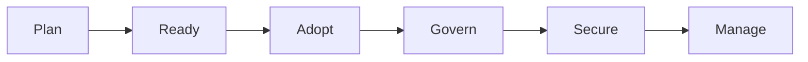
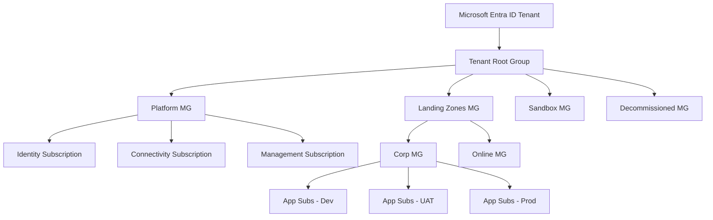
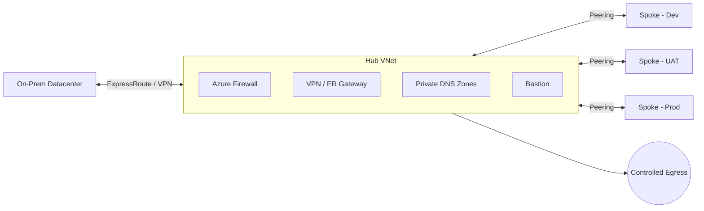
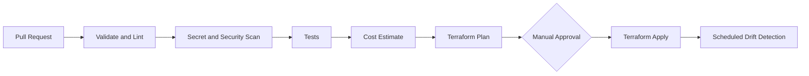
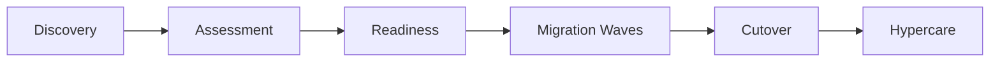

<div align="center">


# Gunjan Kumar — Cloud & DevSecOps Engineer

**Engineering Secure, Governed and Scalable Azure Platforms**

*Landing Zones • Infrastructure as Code • CI/CD Automation • Cloud Migration • FinOps • Vendor Governance*

<br/>

[](#-enterprise-azure-migration--landing-zone-playbook)
[](https://www.linkedin.com/in/gunjankumar5153)
[](mailto:Gunjanrajput026@gmail.com)


</div>

---

## 👨‍💻 About Me

I am a **DevSecOps Engineer** who designs and automates enterprise-grade cloud platforms on **Microsoft Azure**. My work focuses on **secure, governed and cost-optimised** environments built with **Terraform** and **Azure DevOps**, and on leading **large-scale migrations** from on-premises datacenters to the cloud.

My background started in **telecom infrastructure (2019)** and evolved into **cloud and DevSecOps**, which gives me an operations-first mindset: *if it is not automated, monitored and recoverable, it is not production-ready.*

---

## 🛠️ Tech Stack

<div align="center">


</div>

---

## 📌 Featured Repositories

| Repository | Description | Stack |
|-----------|-------------|-------|
| [**Terraform_Module**](https://github.com/gunjanrajput026-ctrl/Terraform_Module) | Reusable Terraform modules for Azure infrastructure | `HCL` `Terraform` |
| [**Axion-system**](https://github.com/gunjanrajput026-ctrl/Axion-system) | Application platform deployed on Azure with IaC | `Azure` `Terraform` |

---

# 🏛️ Enterprise Azure Migration & Landing Zone Playbook

> Migrating **100+ applications** across **Dev, UAT and Production** — multiple subscriptions, on-premises datacenter and cloud workloads — with a platform that is **Scalable • Robust • Secure • Reliable • Portable • Governed • Highly Available • Cost Optimised • Backed up • Monitored • Compliant**.

## 📑 Playbook Index

| # | Section | # | Section |
|---|---------|---|---------|
| 1 | [Scope & Principles](#1--scope--design-principles) | 10 | [Cloud Migration](#10--cloud-migration) |
| 2 | [CAF Strategy](#2--cloud-adoption-framework-caf-strategy) | 11 | [FinOps](#11--finops--cost-optimisation) |
| 3 | [Enterprise Governance & Identity](#3--enterprise-governance--identity) | 12 | [Backup, DR & HA](#12--backup-disaster-recovery--high-availability) |
| 4 | [Tenant & MG Hierarchy](#4--tenant--management-group-hierarchy) | 13 | [Monitoring & Observability](#13--monitoring--observability) |
| 5 | [Hub & Spoke Networking](#5--hub--spoke-networking-model) | 14 | [Vendor Management](#14--vendor-management) |
| 6 | [Security](#6--security-four-layers) | 15 | [Transition & KT](#15--transitions--knowledge-transfer) |
| 7 | [Terraform Landing Zone](#7--terraform-landing-zone-automation) | 16 | [Team Management & Upskilling](#16--team-management--upskilling-strategy) |
| 8 | [Terraform Best Practices](#8--terraform-best-practices) | | |
| 9 | [Azure Repos & Pipelines](#9--azure-repos--devsecops-pipelines) | | |

---

## 1. 🎯 Scope & Design Principles

<details open>
<summary><b>Programme scope</b></summary>

| Item | Detail |
|------|--------|
| Applications | 100+ |
| Environments | Dev, UAT, Production |
| Hosting | Multiple Azure subscriptions, On-premises datacenter, Cloud workloads |
| Connectivity | Hub & Spoke, VPN Gateway, ExpressRoute |
| IaC | Terraform with remote state and policy gates |
| CI/CD | Azure Repos + Azure DevSecOps Pipelines |

</details>

<details open>
<summary><b>Design principles</b></summary>

| Principle | How it is achieved |
|-----------|--------------------|
| **Scalable** | Subscription-per-workload, modular Terraform, VMSS and autoscale |
| **Robust** | Zone-redundant design, tested failover, health probes |
| **Secure** | Zero Trust, Defender for Cloud, private endpoints, centralised inspection |
| **Reliable** | Defined SLOs, RTO/RPO per tier, runbooks |
| **Portable** | Everything as code, standard modules, no portal drift |
| **Governed** | Management Groups, Azure Policy initiatives, group-based RBAC |
| **Highly Available** | Availability Zones, ZRS/GRS, secondary region |
| **Cost Optimised** | FinOps reviews, reservations, auto shutdown/start |
| **Backed up** | Policy-enforced Azure Backup with retention tiers |
| **Monitored** | Azure Monitor, Log Analytics, alerting, dashboards |
| **Compliant** | Policy-as-code, audit logs, exemptions with justification |

</details>

---

## 2. 🗺️ Cloud Adoption Framework (CAF) Strategy

The migration strategy is built on the **Microsoft CAF**, covering **Plan → Ready → Adopt → Govern → Secure → Manage**.



| CAF Area | What we cover |
|----------|---------------|
| **Plan** | Portfolio discovery, business case, assessment, wave planning |
| **Ready** | Landing zone, identity, networking, subscriptions, policies |
| **Adopt** | Migrate (rehost / replatform / refactor), modernise, innovate |
| **Govern** | Azure Policy, RBAC, tagging, cost governance, compliance |
| **Secure** | Defender for Cloud, network and identity security, encryption |
| **Manage** | Monitoring, backup, DR, patching, operations baseline |

---

## 3. 🔐 Enterprise Governance & Identity

<details open>
<summary><b>User, Group, RBAC, Defender, Policy</b></summary>

| Area | Practice |
|------|----------|
| **User Management** | Entra ID lifecycle (joiner / mover / leaver), MFA, Conditional Access |
| **Group Management** | Role-based security groups, dynamic membership where suitable, owners assigned |
| **RBAC** | Least privilege, **groups only (never individuals)**, scoped at MG / Subscription / RG |
| **Privileged Access** | PIM just-in-time elevation, access reviews, break-glass accounts |
| **Defender** | Defender for Cloud (CSPM + workload protection) enabled through policy |
| **Azure Policy** | Initiatives for tagging, allowed regions/SKUs, diagnostics, encryption, backup |

</details>

<details>
<summary><b>Hub & Spoke governance goals</b></summary>

- **Centralised Inspection** — all spoke traffic inspected by the hub firewall.
- **Shared Connectivity** — gateways, DNS and bastion shared from the hub.
- **Controlled Egress** — outbound internet only through the firewall with FQDN filtering.

</details>

---

## 4. 🌳 Tenant & Management Group Hierarchy



<details open>
<summary><b>Hierarchy design</b></summary>

| Topic | Design |
|-------|--------|
| **Entra ID Tenant** | Single identity plane for the organisation |
| **Tenant Root Group** | Holds Platform MG, Sandbox MG, Decommissioned MG and Landing Zones MG |
| **Subscription boundaries** | Separate subscriptions per environment and per workload for blast-radius, quota and billing isolation |
| **Platform subscriptions** | Identity, Connectivity, Management |
| **Application subscriptions** | Dev, UAT, Prod landing-zone subscriptions per application group |
| **Policy & initiatives** | Assigned at MG level and inherited downward |
| **RBAC group formation** | Naming convention such as `grp-<scope>-<role>` mapped to MG/Sub roles |
| **Policy exemptions** | Documented justification, owner, approver and **expiry date** |

</details>

<details>
<summary><b>Subscription onboarding & offboarding</b></summary>

**Onboarding (subscription vending)**
1. Request raised with owner, cost centre, environment and CIDR need.
2. Subscription created and placed under the correct MG.
3. Baseline policies, RBAC groups, budgets and diagnostics applied by Terraform.
4. Spoke VNet deployed and peered to hub.
5. Handover to application team.

**Offboarding**
1. Workload decommission approved.
2. Data retention and backups verified.
3. Resources removed, subscription moved to **Decommissioned MG** (deny-all policy).
4. Billing closed and access revoked.

</details>

<details>
<summary><b>Best practices — Tenant hierarchy & Entra ID</b></summary>

- Keep hierarchy shallow (3–4 levels), designed around policy and RBAC needs rather than org chart.
- Assign policy to **Management Groups**, not individual subscriptions.
- Use dedicated **Sandbox MG** with budget caps and relaxed policy.
- Enforce MFA and Conditional Access for all users; protect admins with PIM.
- Maintain two **break-glass** accounts excluded from CA, monitored with alerts.
- Use **managed identities / service principals with federation** instead of secrets.
- Regular **access reviews** for privileged groups and guest users.

</details>

---

## 5. 🌐 Hub & Spoke Networking Model



<details open>
<summary><b>IP address management & CIDR</b></summary>

- One **central IPAM** sheet / tool; every VNet allocated from it, no ad-hoc ranges.
- **On-premises CIDR assessment first** — collect all on-prem, partner and branch ranges to **avoid overlap** with Azure.
- Reserve ranges per region, per environment and for growth (hub, spokes, gateway, firewall, bastion subnets).
- Use right-sized subnets (e.g. `/26` for firewall, `/27` for gateway, `/26` for bastion minimums).

| Environment | Example allocation |
|-------------|--------------------|
| Hub | `10.0.0.0/22` |
| Dev spokes | `10.10.0.0/16` pool |
| UAT spokes | `10.20.0.0/16` pool |
| Prod spokes | `10.30.0.0/16` pool |

*(Illustrative values — final plan is based on the on-prem assessment.)*

</details>

<details open>
<summary><b>Hub VNet best practices</b></summary>

- Dedicated subnets: `AzureFirewallSubnet`, `GatewaySubnet`, `AzureBastionSubnet`, shared-services subnet.
- Firewall Premium where IDPS / TLS inspection is needed.
- **No workloads in hub** apart from shared services.
- DDoS protection plan on public-facing VNets.
- Diagnostic logs from firewall, gateway and NSG flow logs to Log Analytics.

</details>

<details>
<summary><b>Spoke design, peering, UDR & firewall rules</b></summary>

- One spoke per workload / environment, **peered to hub** (allow forwarded traffic, use remote gateway).
- **UDR**: `0.0.0.0/0` → Firewall private IP on every spoke subnet; on-prem prefixes → Firewall.
- **Firewall rules**: deny by default; Network, Application (FQDN) and DNAT rule collections per application, managed as code.
- **NSGs** on every subnet for east-west control.

</details>

<details>
<summary><b>Private DNS, Private Endpoints, VPN Gateway & ExpressRoute</b></summary>

| Component | Practice |
|-----------|----------|
| **Private DNS Zones** | Centralised in hub (`privatelink.*`), linked to all VNets, resolved via DNS forwarder / Firewall DNS proxy |
| **Private Endpoints** | All PaaS (Storage, SQL, Key Vault, ACR) private only; public network access disabled |
| **VPN Gateway** | Active-active, zone-redundant SKU, IPsec/IKEv2 for site-to-site and backup path |
| **ExpressRoute** | Primary private connectivity to on-prem, with VPN as failover, redundant circuits |

</details>

---

## 6. 🛡️ Security (Four Layers)

| Layer | Controls |
|-------|----------|
| **Identity Level** | MFA, Conditional Access, PIM, managed identities, access reviews |
| **Networking Level** | Hub firewall inspection, NSGs, private endpoints, no public IPs by default, DDoS, WAF |
| **Governance Level** | Azure Policy (deny/audit/modify), resource locks, tagging, exemptions with approval |
| **Compute Level** | Defender for Servers, patching (Update Manager), disk encryption, hardened images, JIT access |
| **Data (cross-cutting)** | Encryption at rest and in transit, Key Vault for secrets/keys/certs |

---

## 7. ⚙️ Terraform Landing Zone Automation



| Capability | Tooling / Approach |
|-----------|--------------------|
| **Reusable modules** | Versioned modules (tagged releases) for network, policy, MG, subscription, monitoring |
| **Linting** | `terraform fmt`, `terraform validate`, `tflint` |
| **Secret scanning** | Pre-commit + pipeline scanning (e.g. gitleaks) |
| **Security scanning** | `checkov` / `tfsec` policy checks |
| **Testing** | `terraform test` / Terratest for modules |
| **Costing** | Infracost estimate posted on every PR |
| **Manual approvals** | Environment approval gates before UAT / Prod apply |
| **Drift detection** | Scheduled pipeline runs `plan` and alerts on any diff |

---

## 8. ✅ Terraform Best Practices

<details open>
<summary><b>Remote state, access & encryption</b></summary>

| Practice | Detail |
|----------|--------|
| **Remote State** | Azure Storage backend, one container per environment, state locking via blob lease |
| **Least-privilege access** | Only pipeline identity has `Storage Blob Data Contributor`; humans read-only via PIM |
| **Encryption at rest** | Storage encryption with platform or customer-managed keys, blob versioning and soft delete |
| **Network protection** | State storage on private endpoint, public access disabled |
| **No secrets in state** | Use Key Vault references and managed identities |

```hcl
terraform {
  backend "azurerm" {
    resource_group_name  = "rg-tfstate-prod"
    storage_account_name = "sttfstateprod001"
    container_name       = "tfstate"
    key                  = "landing-zone/connectivity.tfstate"
    use_azuread_auth     = true
  }
}
```

</details>

<details>
<summary><b>Coding standards</b></summary>

- Small, composable modules with clear inputs/outputs and pinned provider versions.
- One state per blast-radius (connectivity, identity, policy, app stacks).
- Consistent naming and mandatory tags (owner, cost centre, environment).
- No manual portal changes; drift is detected and corrected through pipelines.

</details>

---

## 9. 🔁 Azure Repos & DevSecOps Pipelines

<details open>
<summary><b>Branching strategy & policies</b></summary>

| Item | Standard |
|------|----------|
| **Strategy** | **Trunk-based development** |
| **Feature branches** | Short-lived, merged within days |
| **Pull Requests** | **Mandatory** for every change |
| **Reviewers** | Minimum / maximum reviewers enforced, author cannot self-approve |
| **Build validation** | Validate & Test pipeline must pass |
| **Main branch** | Protected, **no delete**, no direct push, no force push |
| **Code owners** | `CODEOWNERS` for network, security, policy and platform modules |
| **Comment resolution** | All comments resolved before merge |

</details>

<details open>
<summary><b>Pipeline templates</b></summary>

| Template | Purpose |
|----------|---------|
| **Validate & Test** | fmt, validate, lint, secret and security scans, unit tests |
| **Build** | Package and publish module / artifact versions |
| **Deployment** | Plan with environment-specific variables |
| **Apply** | Approved Terraform apply with gated environments |
| **Rollback** | Redeploy last known-good version / restore previous state |

**Other pipeline features:** parallel jobs for independent stacks, reusable YAML templates, environment approvals and checks, scheduled drift detection.

```yaml
stages:
  - stage: Validate
    jobs:
      - template: templates/validate-test.yml
  - stage: Plan
    dependsOn: Validate
    jobs:
      - template: templates/plan.yml
  - stage: Apply
    dependsOn: Plan
    condition: and(succeeded(), eq(variables['Build.SourceBranch'], 'refs/heads/main'))
    jobs:
      - deployment: apply
        environment: prod-approval   # manual approval gate
        strategy:
          runOnce:
            deploy:
              steps:
                - template: templates/apply.yml
```

</details>

<details>
<summary><b>Middleware setup with custom data script</b></summary>

- VM bootstrap through **`custom_data` / cloud-init** for installing and configuring middleware (e.g. Nginx, runtime packages, agents).
- Scripts stored in repo, versioned and reviewed through PR.
- Secrets fetched at runtime from **Key Vault** using managed identity, never embedded in scripts.

</details>

---

## 10. 🚚 Cloud Migration



<details open>
<summary><b>Strategies, discovery, assessment & readiness</b></summary>

| Stage | Activities |
|-------|-----------|
| **Discovery** | Inventory servers, apps, dependencies, owners, data volumes (Azure Migrate) |
| **Assessment** | Sizing, cost, compatibility, risk and complexity scoring |
| **Readiness** | Landing zone ready, connectivity validated, access, backup and monitoring baselines |
| **Strategy** | **Rehost, Replatform, Refactor, Rearchitect, Retire, Retain** |
| **Waves** | Group by dependency and risk; Dev → UAT → Prod |

</details>

<details open>
<summary><b>Pre / During / Post checklists</b></summary>

**✅ Pre-migration**
- [ ] Application owner, dependencies and data flows documented
- [ ] CIDR and DNS plan validated (no overlap with on-prem)
- [ ] Landing zone, firewall rules and private endpoints ready
- [ ] Backups taken and restore tested
- [ ] Rollback plan and success criteria approved
- [ ] Change window and stakeholder sign-off obtained

**🔄 During migration**
- [ ] Replication health and lag monitored
- [ ] Change freeze enforced
- [ ] Cutover runbook followed step by step
- [ ] Communication updates sent on schedule
- [ ] Go / No-Go decision recorded

**🏁 Post-migration**
- [ ] Functional, performance and security validation completed
- [ ] DNS / connectivity switched and verified
- [ ] Monitoring, alerts and backup enabled
- [ ] Source systems retained for agreed period, then decommissioned
- [ ] Cost and tagging review done
- [ ] Documentation updated and handed to operations

</details>

<details>
<summary><b>Cutover & Hypercare</b></summary>

- **Cutover:** final sync, application freeze, switch traffic, smoke tests, business validation, rollback trigger criteria defined.
- **Hypercare:** dedicated support window (typically 2–4 weeks), daily health review, defect triage, SLA tracking, then handover to BAU operations.

</details>

---

## 11. 💰 FinOps & Cost Optimisation

| Area | Action |
|------|--------|
| **Idle resources** | Weekly review through Advisor / Resource Graph, owner confirmation, cleanup |
| **Unattached disks** | Detect with scheduled query, snapshot if needed, delete |
| **Oversized compute** | Right-size using CPU / memory metrics |
| **Unnecessary log ingestion** | Filter noisy tables, set retention tiers, use Basic / Archive logs |
| **Auto shutdown & start** | Dev / UAT VM schedules via automation |
| **Reserved capacity** | Reserved Instances / Savings Plans for steady-state workloads |
| **Backup retention** | Set per tier to avoid over-retention cost |
| **Governance** | Budgets and alerts per subscription, mandatory cost-centre tags, monthly cost review |

---

## 12. 💾 Backup, Disaster Recovery & High Availability

| Topic | Approach |
|-------|----------|
| **LRS** | Dev / non-critical data |
| **ZRS** | Zone-level resilience for production |
| **GRS / GZRS** | Cross-region protection for DR |
| **VMSS** | Scale and spread across zones for stateless tiers |
| **Regions** | **Primary region + secondary (paired) region** |
| **RTO / RPO** | Defined per application tier (Tier 0–3) and tested |
| **Backup** | Azure Backup enforced by policy, tested restores |
| **DR** | Azure Site Recovery with documented, rehearsed failover and failback |

| Tier | Example RTO | Example RPO |
|------|-------------|-------------|
| Tier 0 – Critical | < 1 hour | Near zero |
| Tier 1 – High | 4 hours | 15 min |
| Tier 2 – Medium | 24 hours | 4 hours |
| Tier 3 – Low | 72 hours | 24 hours |

*(Illustrative — actual targets agreed with business owners.)*

---

## 13. 📊 Monitoring & Observability

- **Azure Monitor** with central **Log Analytics** workspace strategy.
- Diagnostic settings enforced by **Azure Policy** on all resources.
- Metric, log and activity-log **alerts** with action groups and escalation.
- **Workbooks / dashboards** for platform health, cost and security posture.
- **Application Insights** for APM, with SLO-based alerting.
- Alerts mapped to runbooks and on-call rotation.

---

## 14. 🤝 Vendor Management

<details open>
<summary><b>Technical task assignment & SOW</b></summary>

| Element | Definition |
|---------|-----------|
| **Scope** | What is in and out |
| **Deliverables** | Documents, code, environments to be handed over |
| **Acceptance criteria** | Measurable conditions for sign-off |
| **Sprints** | Time-boxed delivery plan |
| **Dependencies & Risks** | Tracked with owners and mitigation |
| **Commercials** | Rate card, milestones, penalties |
| **Accountability** | Clear owner per deliverable |
| **SOW** | Single governing document capturing all of the above |

</details>

<details>
<summary><b>Vendor selection — RFI, RFP & evaluation</b></summary>

1. **RFI** to shortlist capable vendors.
2. **RFP** with scope, architecture needs and commercial template.
3. **Technical Evaluation Matrix** scoring architecture capability, certifications, references, tooling and security.
4. **Commercial proposal** comparison (TCO, milestones, exit terms).
5. Final selection and contract.

</details>

<details>
<summary><b>Governance, access & payments</b></summary>

- **Escalation matrix** (L1 → L2 → Delivery Head → Executive sponsor) with response times.
- **Least-privilege** vendor access: dedicated groups, PIM time-bound roles, no shared accounts, activity logged.
- **Weekly review** and **retro calls** to track progress and improvement.
- **Deliverable sign-off** against acceptance criteria.
- **Payment milestones** released only after sign-off, as per contract.

</details>

---

## 15. 🔄 Transitions & Knowledge Transfer

- **Documentation handover:** HLD, LLD, network and IP plan, runbooks, DR plans, pipeline guides.
- **RACI matrix** for every platform activity (Responsible, Accountable, Consulted, Informed).
- **KT sessions:** recorded, with Q&A, followed by shadow → reverse-shadow → ownership.
- Handover accepted through a formal checklist and sign-off.

| Activity | Platform Team | App Team | Vendor | Security |
|----------|:-:|:-:|:-:|:-:|
| Landing zone changes | A/R | I | C | C |
| App deployment | C | A/R | C | I |
| Policy exemptions | R | C | I | A |
| DR drills | A | R | C | I |

---

## 16. 👥 Team Management & Upskilling Strategy

- **Skill matrix** to find gaps across Azure, Terraform, security and DevOps.
- **Certification roadmap:** AZ-104, AZ-305, AZ-500, AZ-400, Terraform Associate.
- **Internal KT sessions and workshops**, brown-bag talks and hands-on labs.
- **New initiatives:** structured **senior-level interviews**, defined role expectations, onboarding KT.
- Pairing and code reviews for continuous learning; regular 1:1s and goal tracking.

---

## 💼 Experience

| Role | Organisation | Period |
|------|--------------|--------|
| **DevSecOps Engineer** | Globis Consultancy Services Pvt. Ltd. | Aug 2025 – Present |
| **Support Function Engineer** | Aerial Telecom Solutions | Dec 2023 – Jul 2025 |
| **NTP Engineer** | Nisom Tele Infra | Jan 2019 – Nov 2023 |

🎓 **B.Tech (ECE)** — Punjab Technical University

---

## 📈 GitHub Stats

<div align="center">


</div>

---

## 🤝 Let's Connect

<div align="center">

[](https://www.linkedin.com/in/gunjankumar5153)
[](mailto:Gunjanrajput026@gmail.com)

<br/>

*"Automate everything, govern by policy, secure by default."*


</div>
